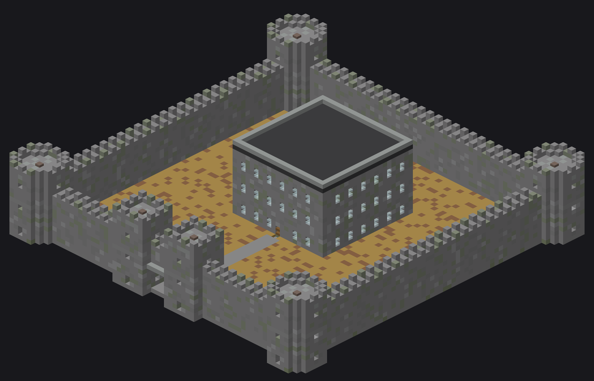
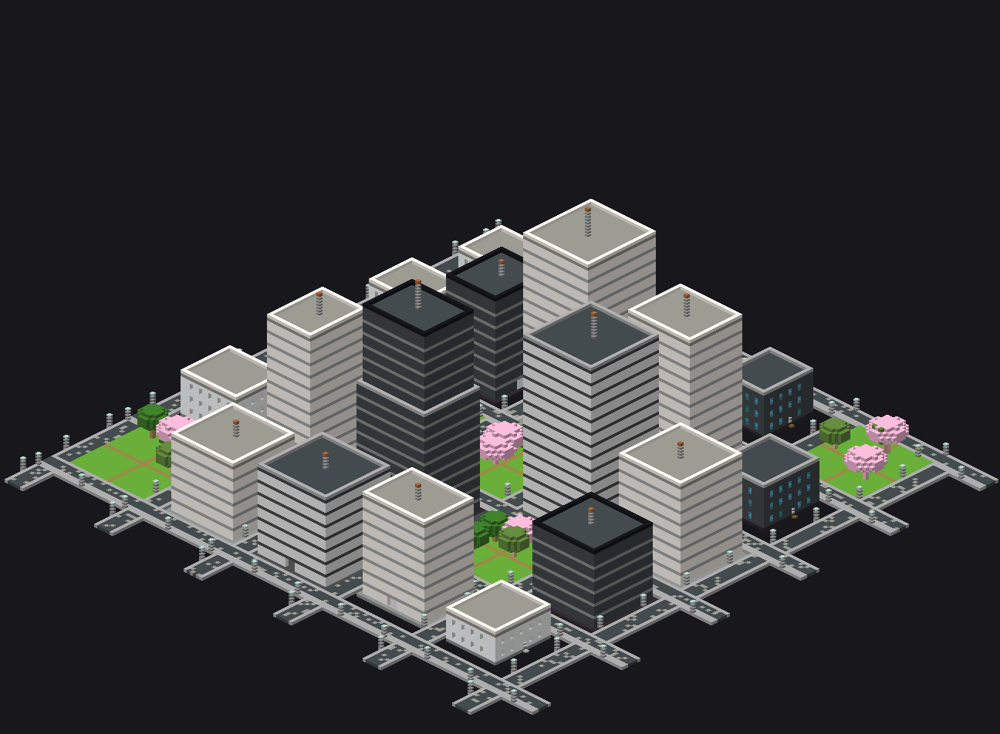
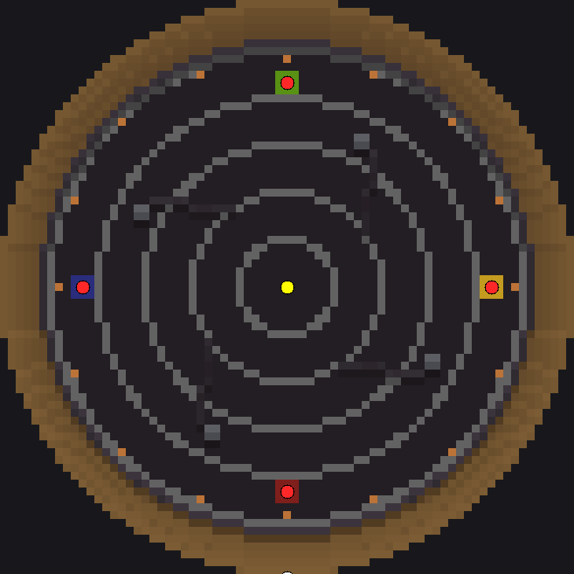

# bedrock-map-builder-mcp

An MCP server that lets Claude (or any MCP client) build, edit and analyse Minecraft: Bedrock Edition maps in a real
world. It doesn't print commands for you to paste: it starts a Bedrock Dedicated Server on your world, writes the
blocks, reads them back to check, and keeps an undo journal.

You ask in plain language ("build a medieval village on that hill", "make a 4 team PvP arena at 0 64 0", "turn the
area around spawn into a lobby with portals to three games"), Claude picks the tools, previews, builds and checks.



## Contents

* [How it works](#how-it-works)
* [Supported versions](#supported-versions)
* [Requirements](#requirements)
* [Install](#install)
* [Connecting to Claude Code](#connecting-to-claude-code)
* [Ways to reach a world](#ways-to-reach-a-world)
* [What it can do](#what-it-can-do)
* [Example requests](#example-requests)
* [Big maps](#big-maps)
* [Undo, backups and safety](#undo-backups-and-safety)
* [Errors](#errors)
* [Tests](#tests)
* [Known limitations](#known-limitations)
* [Troubleshooting](#troubleshooting)
* [Development](#development)

## How it works

```
Claude ── MCP (stdio) ──> bedrock-map-builder-mcp ── stdin: scriptevent ──> bedrock_server
                                │                 <── stdout: console.log ──   └ bridge behavior pack
                                │                                                (@minecraft/server 2.11.0)
                                └── project folder: journal, undo snapshots, plans, palette, markers
```

The server runs a Bedrock Dedicated Server (BDS) and adds a small behavior pack to the world, the bridge. Requests go
in through `/scriptevent`, answers come back on the server console. The bridge uses only the stable script API
(`fillBlocks`, `getBlock`, `getTopmostBlock`, ticking areas, structures, inventories), so no experimental toggles are
needed and the world files are written by the game itself, never by guesswork.

All planning happens on the MCP side: generators produce blocks into a sparse buffer, the apply engine splits that into
64 x 384 x 64 tiles, loads each tile with a ticking area, saves what was there for undo, merges blocks into as few fills
as possible (or sends dense run length data for noisy content) and samples the result to verify it.

## Supported versions

* **Bedrock Dedicated Server 1.26.60 and newer** (the bridge needs `@minecraft/server` 2.11.0). Tested on 1.26.61.1.
* Worlds from the game client of a similar version (tested with worlds from mcpelauncher on Linux). BDS upgrades an
  older world when it opens it, so export back into a client that is at least as new as the server.
* The bundled block list (`src/data/blocks.json`, 1480 blocks) is dumped from BDS 1.26.61.1. When a server is running
  the list is refreshed from it, so validation always matches the version in use.
* BDS on Linux x86_64 is what's tested. The Windows BDS should work the same way but hasn't been tried.

## Requirements

* Node.js 20 or newer
* An unpacked Linux Bedrock Dedicated Server. Download it from
  <https://www.minecraft.net/download/server/bedrock> (you accept Mojang's EULA there; this project doesn't download it
  for you).
* Claude Code, or any other MCP client

## Install

```sh
git clone https://github.com/xRookieFight/bedrock-map-builder-mcp.git
cd bedrock-map-builder-mcp
npm install
npm run build
```

## Connecting to Claude Code

For all your projects (user scope):

```sh
claude mcp add --scope user bedrock-map-builder \
  -e MBM_BDS_DIR=/path/to/bedrock-server-1.26.61.1 \
  -- node /absolute/path/to/bedrock-map-builder-mcp/dist/src/index.js
```

For one project only, use `--scope project` instead; that writes a `.mcp.json` you can commit. `MBM_BDS_DIR` is
optional: without it, ask Claude to run `server_setup`, which searches Downloads and similar folders, or pass the path.

Check it with `claude mcp get bedrock-map-builder` (should say Connected), then ask Claude something like
"preview a small house with the map builder".

### Environment variables

| Variable | Default | Meaning |
| --- | --- | --- |
| `MBM_BDS_DIR` | from `server_setup` | Folder of the unpacked BDS |
| `MBM_DATA_DIR` | `~/.local/share/bedrock-map-builder-mcp` | Managed worlds, backups, projects |
| `MBM_SERVER_PORT` | `19140` | UDP port of the managed server, join it from the game to look around |
| `MBM_WS_PORT` | `19150` | Port for `/connect` |
| `MBM_PROJECT` | `default` | Project opened at start |
| `MBM_CLIENT_WORLDS` | | Extra folders (colon separated) to look for client worlds |
| `MBM_START_TIMEOUT_MS` | `180000` | How long BDS gets to start |

## Ways to reach a world

| Way | How | Read back | Undo | Analysis and export |
| --- | --- | --- | --- | --- |
| New managed world | `world_create` | yes | yes | yes |
| Existing world (offline edit) | `world_import` from a client folder or `.mcworld`, `server_start`, then `world_export` | yes | yes | yes |
| World open in the game | `ws_listen`, then type `/connect localhost:19150` in game | no | while the world stays open | no |

**Offline editing** means the world is copied into the builder, opened in a headless BDS, edited, and copied back.
The original is never touched until `world_export`, and whatever export overwrites is backed up first. The bridge pack
reference is removed again on export, and the builder's own structures are swept out, so the map you hand back is clean.

**Live editing in the client** uses Bedrock's `/connect` WebSocket protocol, which carries commands only: blocks can be
written with `/fill` and `/setblock`, and undo uses `/structure save ... memory` (kept in memory, never saved into the
map). Nothing can be read back, so analysis, copy, export and terrain aware generators need a managed world. Cheats must
be on, and newer clients have a "Require Encrypted Websockets" setting that has to be off, since encryption isn't
implemented.

You can also join the managed server from your game (Add Server, `localhost`, port 19140) to walk around the build
while Claude works on it.

## What it can do

51 tools in a few groups. Claude sees short descriptions of each; `generator_help` gives full argument schemas.

**World and server**: `server_setup`, `server_status`, `server_start`, `server_stop`, `server_console`, `world_list`,
`world_create`, `world_import`, `world_export`, `world_backup`, `world_backups`, `world_restore`, `ws_listen`,
`ws_status`, `ws_stop`, `use_connection`

**Building**: `generate` runs any of 22 generators, with `dry_run` previews as images:

| Generator | Builds |
| --- | --- |
| `house` | Foundation, walls, windows, door, floors with stairs, lights, furniture; gable, hip, flat, dome or no roof |
| `tower` | Round or square, spiral stairs, arrow slits, battlements, cone, dome or flat top |
| `wall` | Wall along any path with walkway, crenellations and towers |
| `castle` | Curtain wall, corner towers, gatehouse, keep, courtyard |
| `bridge` | Deck between two points, railings, lamps, arches, ramps |
| `road` | Road along a path with edges, lamp posts and cleared headroom |
| `skyscraper` | Glass and frame tower, floors, lights, setbacks, antenna, lobby |
| `city` | Road grid, taller towers toward the centre, houses, parks |
| `arena` | PvP, FFA or KitPvP arena: team spawns, rotationally symmetric cover, seating, barrier roof |
| `parkour` | Jump course within sprint jump reach, checkpoints, start and finish |
| `lobby` | Spawn lobby with fountain, paths to named portals |
| `dungeon` | Connected rooms and corridors, chests, boss room, stairs up |
| `tree`, `vegetation` | Ten tree types, bushes, rocks and plants scattered on the real ground |
| `terrain` | Plains, hills, mountains, islands, dunes, plateau, canyon, flat; blends into the existing ground |
| `sculpt` | Raise, lower, flatten, level or smooth existing terrain |
| `river`, `lake`, `caves`, `mountain` | Water courses, lakes, cave tunnels, mountains and volcanoes |
| `shapes` | Box, sphere, ellipsoid, cylinder, cone, pyramid, line, torus, arch, prism, path wall |
| `script` | Free JavaScript with a building API, for anything the others don't cover |

| `city` preview | `arena` with 4 teams, top down with spawn markers |
| --- | --- |
|  |  |

Twelve style palettes (medieval, castle, modern, skyscraper, fantasy, scifi, desert, nordic, japanese, nether, rustic,
ice) map roles like wall, roof, trim and light to blocks, with weighted mixes so walls don't look stamped. `palette_set`
pins project wide choices.

Direct editing: `fill_region` (solid, hollow, walls, outline, floor, ceiling; mixes; replace and keep filters),
`replace_blocks`, `clear_region`, `place_blocks`, `copy_region` (copy, move, rotate, mirror, repeat), `structure_import`
and `structure_export` for `.mcstructure` files, `block_search`, `block_info`.

**Game logic**: `run_commands`, `set_world_rules` (spawn, gamerules, time, weather, difficulty), `spawn_entities`,
`fill_container` (loot and kits), `set_sign`, `map_functions` (writes `.mcfunction` files into a map behavior pack,
Bedrock's way of doing what command block chains do).

**Looking and checking**: `view` (isometric, top down, slice or heightmap images of a preview or of the world),
`region_stats`, `find_blocks`, `list_entities`, `markers`, `check_map` (spawn safety, reachability on foot, symmetry,
floating blocks, dark spots where mobs can spawn).

**Projects and plans**: `project_open`, `project_info`, `project_note`, `region_mark`, `op_list`, `op_undo`,
`plan_create`, `plan_show`, `plan_list`, `plan_edit`, `plan_run`.

Block names are Bedrock ids and get checked before anything is written. Common Java names are translated
(`oak_door` to `wooden_door`, `dirt_path` to `grass_path`, ...) and typos get suggestions.

## Example requests

* "Make a new flat world called arena_test and build a circular 4 team PvP arena, radius 30, nether style, at 0 -60 0.
  Check that every spawn is safe and the arena is symmetric."
* "Import my world SMPArena from the launcher, back it up, and put a medieval village of six houses with roads between
  them on the plain east of spawn. Show me a preview first."
* "Raise a mountain range along the north edge, from x 0 to 400, and blend it into the existing ground."
* "Build a hard parkour of 40 jumps from the lobby's north portal and fill a reward chest at the finish."
* "Copy the house at 10 64 10 to 60 64 10 rotated 90 degrees, then make three more copies every 20 blocks along x."
* "Write functions that teleport tagged red and blue players to their team spawns, and run them every tick while a
  game is on."
* "Recreate the Java build in this screenshot." (Claude reads the picture, works out sizes and palette, and builds it
  with shapes, script or the generators; anything that can't be copied exactly is reported.)

## Big maps

* Every edit is split into 64 x 384 x 64 tiles. Each tile is loaded, snapshotted, written and checked on its own, so an
  edit of any size runs in bounded memory and doesn't need a player nearby.
* Blocks are merged into the fewest fills possible (a solid 64 x 20 x 64 slab becomes 4 fills); noisy content like
  terrain goes as run length data instead. The worst case, an 80 000 block checkerboard, takes about 13 seconds on a
  laptop; regular builds are much faster.
* One call is capped at 20 million blocks. Bigger jobs go into a plan: `plan_create` stores the steps, `plan_run`
  works through them and saves progress after every step.
* If a run stops halfway (crash, restart, closed session), the journal knows which tiles are done. Running the same plan
  again resumes the unfinished edit from where it stopped, after checking that the regenerated content is identical.
* Generators are seeded and position based, so the same call always produces the same blocks.

## Undo, backups and safety

* **Undo**: before a tile is written, its previous blocks are saved into the project folder
  (`projects/<name>/snapshots`). `op_undo` paints them back. Undo refuses when a later edit overlaps the same area, so
  you can't wipe newer work by accident (unless you force it). Nothing from the undo system is stored inside the map.
* **Backups**: `world_backup` makes a full copy; while the server runs it uses `save hold`, `save query` and
  `save resume` so the copy is consistent. `world_restore` backs up the current state before replacing it.
* **Imports and exports**: the original world is only written by `world_export`, and the overwritten version is backed
  up first under `backups/exports`.
* **The managed server** runs with online mode on, LAN discovery off, no allow list, on port 19140. It's meant for local
  use; don't forward the port.
* **Scripts**: the `script` generator runs JavaScript in a separate Node vm context with a 20 second timeout and a block
  cap. A vm context is not a security sandbox; the code comes from the same local session that already has shell access.
* No credentials are stored. Worlds, backups and projects live in the data folder, outside the repository.

## Errors

* Bad arguments come back as readable messages naming the field, before anything is written.
* Unknown blocks or states fail with suggestions and the valid values.
* Coordinates outside the build height of the dimension, or past the world edge, are refused.
* A tile that fails is reported with its box and the game's error, the others continue, and the op is marked
  `partial`. Run it again (or the plan) to finish it, or `op_undo` it.
* Each edit reads back a sample of blocks and reports mismatches in `verify`.
* If BDS fails to start, the error includes the last console lines.

## Tests

```sh
npm test                                   # unit tests, no Minecraft needed
MBM_BDS_DIR=/path/to/bds npm run test:bds  # against a real Bedrock Dedicated Server
```

What is covered right now:

* Unit (52 tests): block parsing, geometry limits, voxel storage, fill merging, run length encoding, rotation and
  mirroring with block states, NBT and `.mcstructure` round trips, zip, command encoding, every generator producing
  only valid Bedrock blocks, arena symmetry, parkour and dungeon reachability, script timeouts, rendering, and the
  `/connect` protocol against a fake client.
* Real BDS 1.26.61.1: fill, read back, block states, undo, chunk loading far from spawn, an 80 000 block edit, error
  reporting, commands, live backup, heightmaps; `.mcstructure` files written by this project load with
  `/structure load`; and a full MCP client session (setup, world creation, arena with checks, filters, rotated copy,
  structure export and import, a plan, game logic, container filling, `.mcworld` export).
* Claude Code: installed in user scope and driven through `claude -p` (world creation, a tower build verified
  with 0 mismatches).

Not tested: the `/connect` link against a real game client, the Windows BDS, worlds from consoles or mobile.

## Known limitations

* **Block entity data** (chest contents, sign text, banner patterns) is not part of undo snapshots, `copy_region` or
  `structure_export`. Blocks come back, their contents don't. `fill_container` and `set_sign` set them after a build.
* **Live client editing** over `/connect` is commands only: no reading, so no analysis, copy, export or terrain aware
  generation. Encrypted WebSockets aren't implemented. This path has only been tested against a fake client.
* **Offline editing needs BDS** on the same machine. There's no direct LevelDB editing; the game itself opens and saves
  the world, which avoids corrupting it but means a matching server version is needed.
* **Command blocks** can be placed but their command text can't be set through the script API. Use `map_functions`
  instead, which is the supported Bedrock route.
* **Entities** inside a region are not undone or copied.
* **Odd team counts** (3, 5, 7) in `arena` use rounded rotation, so cover is close to but not exactly symmetric.
* **Java features** that Bedrock lacks (NBT on blocks and items, data packs, some block states) are not emulated;
  generators use the Bedrock equivalent and report anything they had to change.
* Directional states of doors and a few rarer blocks follow the registry's aliases; if one ever faces the wrong way,
  `place_blocks` with an explicit state fixes it.

## Troubleshooting

* **"no BDS folder configured"**: run `server_setup` with `bds_dir`, or set `MBM_BDS_DIR`.
* **Server doesn't start**: `server_status` shows the console. Common causes: the port is taken (set `MBM_SERVER_PORT`),
  the BDS is older than 1.26.60 (the bridge needs script API 2.11.0), or another process holds the world.
* **"timed out"**: a very large read or fill on a slow machine. Split the box or use a plan.
* **Blocks don't appear**: check `op_list`; a `partial` op lists failing tiles and why. `view` with `source=world`
  shows what's really there.
* **`/connect` does nothing**: cheats on, "Require Encrypted Websockets" off, the port matches `ws_listen`, and only
  one client at a time.
* **Undo refuses**: a later edit overlaps; undo that one first, or pass `force`.
* **Claude Code doesn't list the tools**: `claude mcp get bedrock-map-builder` should say Connected; if not, run
  `node dist/src/index.js` by hand to see the error, and make sure `npm run build` ran.

## Development

```
bridge-pack/      behavior pack that runs inside BDS (plain JS, no build step)
src/core/         blocks, geometry, voxel buffer, NBT, .mcstructure, noise, transforms, registry
src/engine/       BDS and WebSocket backends, apply engine, reads, projects, journal, sessions
src/gen/          palettes and generators
src/render/       PNG previews
src/analysis/     playability checks
src/tools/        MCP tool definitions
test/, test-bds/  unit and real server tests
scripts/          maintenance scripts (block registry dump)
```

See [CONTRIBUTING.md](CONTRIBUTING.md) for how to add a generator or a tool.

## License

MIT. Minecraft is a trademark of Mojang Studios and Microsoft; this project is not affiliated with them.
